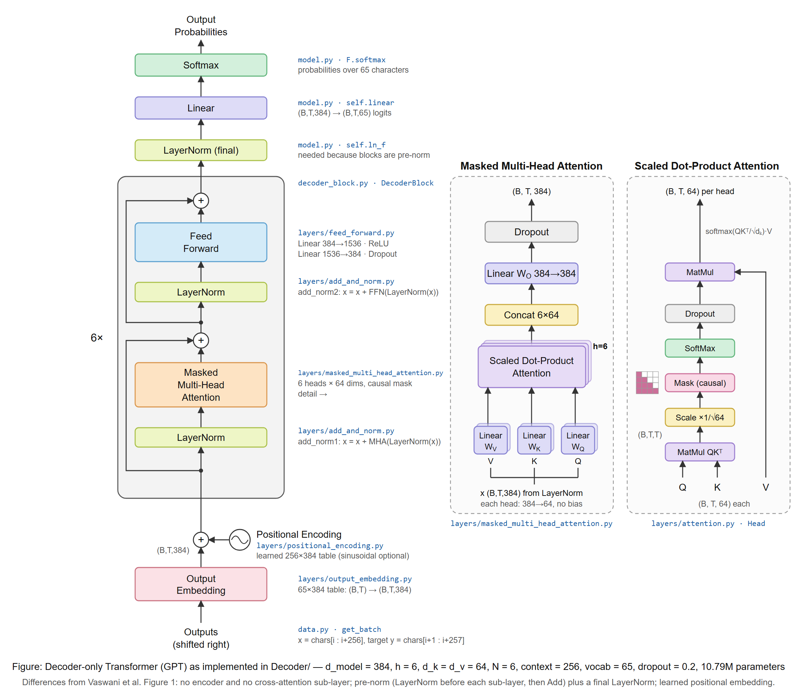

# Decoder-only Transformer (GPT)

A character-level GPT trained on Tiny Shakespeare, split into one file per block of the
Transformer architecture from [Attention Is All You Need](https://arxiv.org/abs/1706.03762)
(Vaswani et al., 2017). File and class names follow the box labels of the paper's Figure 1,
so the code can be read side by side with the diagram.



## Project structure

```
Decoder/
├── config.py                  hyperparameters
├── data.py                    tokenizer, train/val split, get_batch
├── decoder_block.py           joins layers: LayerNorm → MaskedMHA → + → LayerNorm → FFN → +
├── model.py                   joins everything: embedding + PE → 6× DecoderBlock → LN → Linear → Softmax
├── train.py                   training loop; saves the best model to checkpoints/model.pt
├── generate.py                loads the checkpoint and continues your own text
├── checkpoints/               created by train.py (git-ignored)
│   └── model.pt
├── layers/
│   ├── __init__.py
│   ├── output_embedding.py
│   ├── positional_encoding.py
│   ├── attention.py
│   ├── masked_multi_head_attention.py
│   ├── add_and_norm.py
│   └── feed_forward.py
└── docs/
    ├── architecture.png
    └── architecture.svg
```

## Paper ↔ code map

| Figure 1 box | Paper section | File | Class / function |
|---|---|---|---|
| Outputs (shifted right) | 3.1 | `data.py` | `get_batch` — target `y` is input `x` shifted by one |
| Output Embedding | 3.4 | `layers/output_embedding.py` | `OutputEmbedding` |
| Positional Encoding | 3.5 | `layers/positional_encoding.py` | `PositionalEncoding` (sinusoidal), `LearnedPositionalEncoding` |
| Scaled Dot-Product Attention (Fig. 2) | 3.2.1, eq. 1 | `layers/attention.py` | `scaled_dot_product_attention`, `Head` |
| Masked Multi-Head Attention | 3.2.2 | `layers/masked_multi_head_attention.py` | `MaskedMultiHeadAttention` |
| Add & Norm | 3.1 | `layers/add_and_norm.py` | `AddNorm` |
| Feed Forward | 3.3, eq. 2 | `layers/feed_forward.py` | `FeedForward` |
| N× decoder layer | 3.1 | `decoder_block.py` | `DecoderBlock` |
| Linear, Softmax | 3.4 | `model.py` | `self.linear`, `F.softmax` in `generate` |

Dependency order (each file imports only those above it):

```
attention.py → masked_multi_head_attention.py ┐
add_and_norm.py                               ├→ decoder_block.py ┐
feed_forward.py                               ┘                   ├→ model.py → train.py
output_embedding.py, positional_encoding.py ──────────────────────┘
config.py, data.py ───────────────────────────────────────────────────────────→ train.py
```

## Differences from the paper

| Paper (Figure 1) | This code | Why |
|---|---|---|
| Encoder + decoder | Decoder only, no encoder | Language modelling needs no separate source sequence (GPT design) |
| Decoder layer has 3 sub-layers | 2 sub-layers: masked self-attention, feed forward | Cross-attention reads the encoder output, which does not exist here |
| Post-norm: `LayerNorm(x + Sublayer(x))` | Pre-norm: `x + Sublayer(LayerNorm(x))` | More stable training; used from GPT-2 onwards |
| No final LayerNorm | Final `LayerNorm` before `Linear` | Pre-norm leaves the residual stream un-normalised |
| Sinusoidal positional encoding | Learned positional embedding (sinusoidal selectable) | Paper reports near-identical results (Table 3, row E) |
| Embedding scaled by √d_model | Not scaled | Small init (std 0.02) used instead |
| Word-piece tokens | Characters (65-symbol vocabulary) | Keeps the tokenizer trivial |

## Hyperparameters (`config.py`)

| Name | Value | Paper symbol |
|---|---|---|
| `n_embd` | 384 | d_model |
| `n_head` | 6 | h |
| `n_embd // n_head` | 64 | d_k = d_v |
| `4 * n_embd` | 1536 | d_ff |
| `n_layer` | 6 | N |
| `block_size` | 256 | max context length |
| `dropout` | 0.2 | P_drop |
| `batch_size` | 64 | |
| `learning_rate` | 3e-4 (AdamW) | |
| `max_iters` | 5000 | |
| `positional_encoding` | `'learned'` | `'sinusoidal'` = paper |

Total: **10.79M parameters**.

## Tensor shapes through one forward pass

`B` = batch size, `T` = sequence length (≤ 256), `C` = 384, `hs` = 64.

| Step | Shape |
|---|---|
| Input token ids | `(B, T)` |
| Output Embedding | `(B, T, C)` |
| + Positional Encoding (`(T, C)`, broadcast) | `(B, T, C)` |
| Q, K, V per head | `(B, T, hs)` |
| Attention scores `QKᵀ/√hs`, masked, softmax | `(B, T, T)` |
| Head output | `(B, T, hs)` |
| Concat 6 heads + projection | `(B, T, C)` |
| Feed Forward hidden | `(B, T, 4C)` |
| DecoderBlock output (×6) | `(B, T, C)` |
| Linear (logits) | `(B, T, 65)` |

## Setup

From the repository root (`Transformer/`):

```powershell
python -m venv myenv
myenv\Scripts\activate
pip install -r requirements.txt
```

`requirements.txt` installs the CUDA 12.8 build of PyTorch. On a machine without an NVIDIA GPU,
install the CPU build instead (`pip install torch`); `config.py` falls back to CPU automatically.

Download the dataset into `Decoder/`:

```powershell
curl.exe -o Decoder\input.txt https://raw.githubusercontent.com/karpathy/char-rnn/master/data/tinyshakespeare/input.txt
```

## Run

Run from inside `Decoder/` so the `layers` package resolves:

```powershell
cd Decoder
python train.py
```

The script prints the parameter count, train/val loss every 500 steps, and finally 500
characters of generated text. Training on CPU is very slow at these settings; reduce
`n_layer`, `n_embd`, `block_size` or `max_iters` in `config.py` for a quick run.

Whenever the validation loss improves, `train.py` saves `checkpoints/model.pt` containing the
weights, the model hyperparameters and the character vocabulary. Validation loss bottoms out
around step 3000 and then rises (overfitting), so the saved file is the best model, not the last one.

## Generate from your own text

```powershell
python generate.py "ROMEO:\nWhat light"                  # continue a prompt (\n = line break)
python generate.py "KING:" --max_new_tokens 1000 --seed 42
python generate.py                                       # interactive: type prompts, Ctrl+C to quit
```

| Option | Default | Meaning |
|---|---|---|
| `prompt` | none (interactive) | text the model continues |
| `--max_new_tokens` | 500 | characters to generate |
| `--seed` | random | fix sampling for repeatable output |
| `--checkpoint` | `checkpoints/model.pt` | which saved model to load |

The prompt may only use the 65 characters found in `input.txt`: `A–Z`, `a–z`, space, newline,
`! $ & ' , - . 3 : ; ?` (no other digits). Any other character is reported and rejected. `generate.py` does
not need `input.txt`: the vocabulary is stored in the checkpoint.

## Regenerating the diagram

`docs/architecture.svg` is the source. To re-export the PNG with Microsoft Edge (Windows):

```powershell
& "C:\Program Files (x86)\Microsoft\Edge\Application\msedge.exe" --headless --disable-gpu --hide-scrollbars `
  --force-device-scale-factor=2 --window-size=1150,1010 `
  --screenshot="$PWD\docs\architecture.png" "file:///$($PWD -replace '\\','/')/docs/architecture.svg"
```

## Credits

Model and training code adapted from Andrej Karpathy's
[nanoGPT lecture code](https://github.com/karpathy/ng-video-lecture) (`gpt.py`), restructured
into per-block modules.
